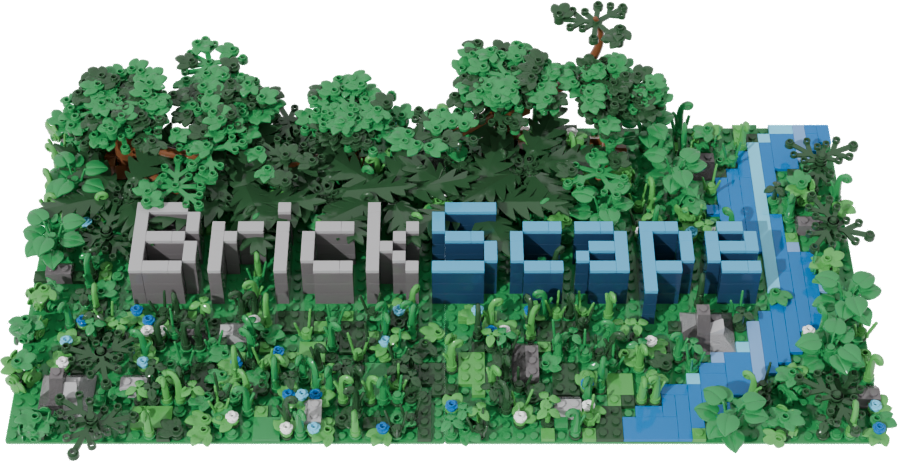
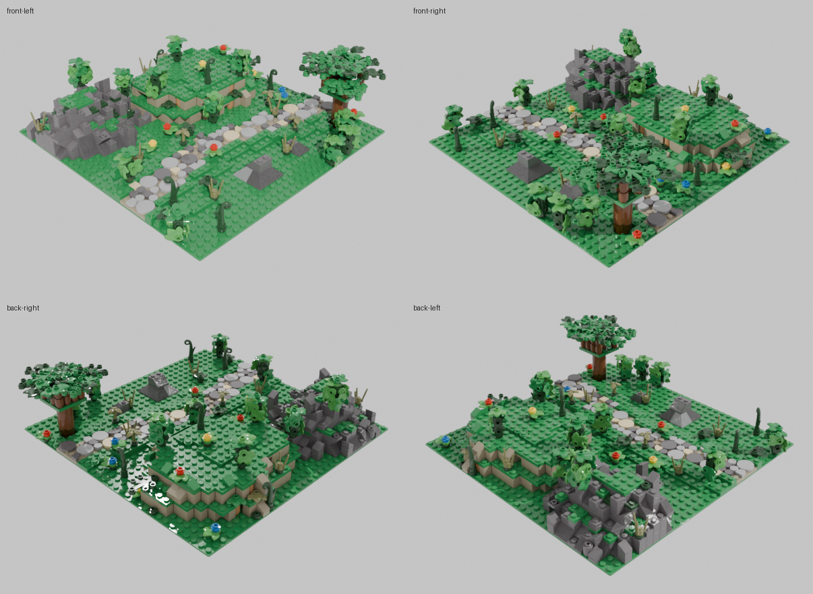
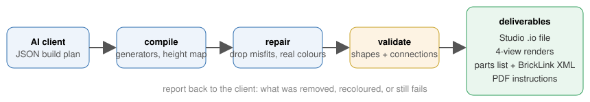
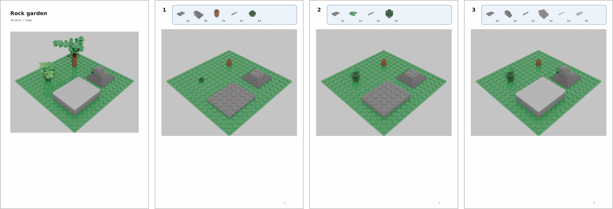
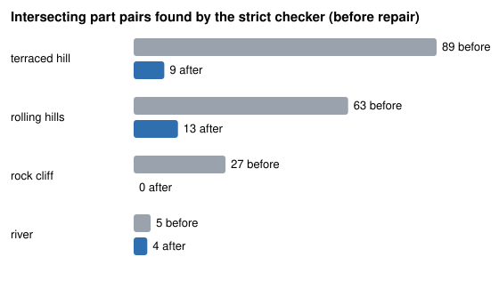

<p align="center"></p>

# brickscape

**Landscape, but for bricks.** An [MCP](https://modelcontextprotocol.io) server that lets an AI
design LEGO builds that can actually be built.

Ask a language model for a LEGO model and you usually get a file with parts floating in the
air, bricks pushed through each other, and part numbers that don't exist. brickscape gives the
model a better way to work: it describes *what* it wants in a short JSON plan (a terraced
hill here, a cobbled path there, an oak by the stream), and brickscape places every part on
real studs, checks the result against the parts' real shapes and connection points, repairs
what it can, and hands back a BrickLink Studio file, renders, a part list and step-by-step
instructions.

<p align="center"></p>
<p align="center"><sub>The <a href="examples/forest-clearing.json">example plan</a> (six operations) as built by brickscape:
806 parts, every one connected, no intersections.</sub></p>

## Contents
- [How it works](#how-it-works)
- [Install](#install)
- [Tools](#tools)
- [Build plans](#build-plans)
- [What "buildable" means here](#what-buildable-means-here)
- [Benchmark](#benchmark)
- [Command line](#command-line)
- [Limitations](#limitations)
- [Credits](#credits)

## How it works

<p align="center"></p>

1. **Plan, don't place.** The client never computes LDraw coordinates. It sends operations
   such as `hill`, `path`, `water`, `tree` or `block` with areas in studs. The compiler turns
   each one into parts using terrain and plant generators written against real building
   techniques (hollow frames, leaning cliff faces, paths set into the ground, leaves on studs).
   A height map means later operations land on top of earlier ones.
2. **Fit as you go.** Every decorative part (leaves, stems, flowers) is checked against its
   neighbours as it is placed. If it clashes it is turned about its stud, and if no turn fits it
   is left out. Bar-ended stems are slid down their stud until the bar is really held.
3. **Repair.** After compiling, parts that are loose or clash are removed when nothing depends
   on them, and every part/colour pair that doesn't exist in real LEGO is moved to the nearest
   colour (by perceived colour distance) that does.
4. **Validate.** The strict checker runs on everything that leaves the server (details
   [below](#what-buildable-means-here)). The report says what was removed, recoloured or still
   fails, and what was *not* checked.
5. **Deliver.** A Studio `.io` file, four renders from fixed angles, a part list
   (CSV and BrickLink wanted-list XML), and on request PDF instructions.

<p align="center"></p>
<p align="center"><sub>Generated instructions: the build order follows the connection graph, so every step can really be built.</sub></p>

## Install

Requires Python 3.10+ and [Blender](https://www.blender.org) 4.x (for renders and instructions).

```bash
pip install git+https://github.com/xanzure/brickscape
brickscape setup
```

`brickscape setup` downloads the LDraw parts library and the ImportLDraw Blender add-on (through
[ldraw-mcp](https://github.com/musharna/ldraw-mcp)), the LDCad connection data, and
Rebrickable's part and colour tables into `~/.cache/brickscape`. None of these are bundled.

Add the server to your MCP client:

```bash
claude mcp add brickscape -- brickscape-mcp          # Claude Code
```

```json
{ "mcpServers": { "brickscape": { "command": "brickscape-mcp" } } }
```
(Claude Desktop and other clients: add the block above to the client's MCP config.)

| Environment variable | Default | Meaning |
|---|---|---|
| `BRICKSCAPE_OUT` | `./brickscape-out` | where builds are saved |
| `BRICKSCAPE_SOURCE` | `lego` | default part source: `lego` or `gobricks` |
| `LDRAW_LIBRARY_PATH` | `~/.ldraw` | LDraw parts library |
| `LDRAW_MCP_BLENDER` | `blender` on PATH | Blender binary |

## Tools

| Tool | What it does |
|---|---|
| `guide` | The planning guide: coordinates, every operation, style tips, an example. Read first. |
| `search_parts` | Find parts by description, with availability and colour count at the part source. |
| `part_info` | A part's size, its connection points (studs, anti-studs, bars, clips, hinges) and real colours. |
| `build` | Compile a plan, repair it, validate it, save it. Returns the validation report. |
| `render` | The four standard views (front-left, front-right, back-right, back-left) as one image. |
| `parts_list` | `parts.csv` and `bricklink.xml` (a BrickLink wanted list); prices in GoBricks mode. |
| `export` | A BrickLink Studio `.io` file. |
| `instructions` | Step-by-step building instructions as a PDF (plus an `.ldr` with `STEP`s for Studio). |
| `check` | Strictly validate any `.ldr`, `.mpd` or `.io` file, including ones not made by brickscape. |

**Part sources.** `lego` (default) accepts only part/colour pairs LEGO has produced, from
Rebrickable's element data. `gobricks` uses GoBricks moulds, colours and prices; it needs a
GoBricks catalog in `~/.cache/brickscape/gobricks` (not distributed).

## Build plans

```json
{
  "name": "forest clearing",
  "board": {"width": 32, "depth": 32},
  "seed": 1,
  "ops": [
    {"op": "hill", "area": {"ellipse": [22, 24, 9, 7], "rough": 0.5}, "height": 8, "style": "terraces"},
    {"op": "hill", "area": {"ellipse": [6, 26, 5, 4]}, "height": 12, "style": "rock"},
    {"op": "path", "points": [[0, 10], [14, 13], [31, 9]], "width": 3, "style": "cobble"},
    {"op": "boulder", "at": [[12, 3, 4], [20, 4, 2]]},
    {"op": "tree", "kind": "oak", "size": "medium", "at": [27, 4]},
    {"op": "scatter", "area": {"rect": [0, 0, 32, 32]}, "kinds": ["tuft", "flower", "bush"], "density": 0.06}
  ]
}
```

Coordinates are studs: `x` runs left to right, `z` from the front edge (0) to the back; heights
are plates (3 plates = 1 brick). Boards of any size work: multiples of 16 get baseplates,
other sizes a floor of plates.

| Operation | Builds |
|---|---|
| `hill` | Raised ground: `terraces` (grass treads, earth and stone risers) or `rock` (an outcrop with cliff faces that lean back, grass on top). |
| `block` | A raised area built like real LEGO: hollow brick frame, crossed plate decks, tiles, studs or grass on top. |
| `path` | A cobbled or dirt path set into the ground, with raised verges. |
| `water` | A stream along points or a pond over an area: smooth tiles, ripples, banks raised 1-2 plates. |
| `boulder` | Rounded boulders of 1, 2, 4 or 6 studs. |
| `tree` | Oak (small, medium, tall, fat, big), birch, pine, palm, cypress; moves up to 2 studs to find room. |
| `plant` / `scatter` | Single plants, or plants scattered over an area: tufts, flowers, bushes, ferns, reeds, bamboo, cactus, succulents, stones, trees. |
| `brick` | One part at an exact stud position. |
| `ldraw` | Raw LDraw part lines, for anything the generators don't cover (still validated). |

Areas are `rect`, `ellipse`, `polygon` or a `cells` list, with an optional `rough` edge.

## What "buildable" means here

The checker works on the parts' real geometry, not their bounding boxes:

| Check | How |
|---|---|
| Real parts | Every part exists in the LDraw library and at the part source. |
| Real colours | Every part/colour pair exists (LEGO: produced elements; GoBricks: sold colours). |
| Rotations | Proper rotations only: no mirrored or scaled parts. |
| No duplicates | No two identical parts in the same place. |
| No intersections | Each part's mesh is ray-cast into a stack of solid boxes (1.25 LDU columns, hollow undersides and tubes kept hollow). Two parts clash if they interpenetrate deeper than 0.8 LDU. Leaves may rest on each other up to 4 LDU, since real leaves bend. |
| Connected | Typed connection points from the [LDCad shadow library](https://github.com/RolandMelkert/LDCadShadowLibrary): studs into anti-studs, bars into holes and clips, hinge fingers, pins and balls. A connection needs coaxial, overlapping, size-compatible points of opposite gender. Every part must reach the baseplate through these connections. |

It does **not** check balance under gravity or how firmly parts clutch, and it says so in every
report.

The checker was tuned on real models made by human designers in BrickLink Studio (their
remaining reports are mostly parts the connection data doesn't cover, such as some flower
stems), and it immediately found real problems in this project's own earlier generators:

<p align="center"></p>

Those remaining pairs are what the repair step then removes. All 25 plant and rock generators
pass the strict check on their own (`pytest`).

## Benchmark

Does an AI design better LEGO with brickscape than without it? The benchmark answers this
with blind, position-swapped judging.

**Prompts** ([bench/prompts.json](bench/prompts.json)): three broad briefs and three with
constraints.

| id | kind | brief |
|---|---|---|
| forest-stream | broad | A small forest clearing with a stream running through it. |
| mountain-pass | broad | A rocky mountain pass with a path winding between the rocks. |
| lakeside | broad | A peaceful lakeside scene with a rocky shore and some trees. |
| garden-20 | constrained | On a 20 x 20 flat space: a garden with a pond, flower beds and a path; at most 400 parts. |
| cliff-grey-green | constrained | On 32 x 16: a cliff along the back at least 4 bricks tall; only grey and green parts. |
| big-tree-16 | constrained | On 16 x 16: one large tree with roots and undergrowth; fewer than 250 parts. |

**Method** ([bench/run.py](bench/run.py)):
1. For each prompt, two fresh headless Claude Code sessions get the same brief and the same
   requirements (real parts and colours, physically buildable, deliver `model.ldr`). Each runs
   in its own empty folder with no project instructions, no memory and no other MCP servers.
   One has brickscape; the other has the same file and shell tools and the LDraw library path.
2. Both models go through the same renderer (the same four camera angles) and the same strict
   checker.
3. A fresh Claude session judges: it sees the brief, the two render sheets labelled A and B and
   both checker summaries, and picks the better build. A second fresh session judges again with
   A and B swapped, so the position can't decide.
4. brickscape wins a prompt if it wins both rounds, ties if the rounds split, and loses
   otherwise. Results: **win rate** and **win-or-tie rate**, plus how many builds of each side
   pass the strict checker.

**Results:** not published yet. Run it with:

```bash
python bench/run.py                 # build, render, judge, report
```

The report writes `bench/results/<date>/results.json` and the charts and table in
`docs/bench/`, which this section will show.

## Command line

```bash
brickscape guide                         # the planning guide
brickscape build examples/forest-clearing.json
brickscape render forest-clearing        # 4 standard views
brickscape export forest-clearing        # Studio .io
brickscape parts forest-clearing         # parts.csv + bricklink.xml
brickscape instructions forest-clearing  # PDF
brickscape check some_model.io           # validate any model
```

## Limitations

- Generators are landscape-focused: terrain, rock, water, paths and plants. Buildings and
  vehicles have to come from `brick` / `ldraw` operations.
- Connection checking is only as complete as the LDCad data. Parts without detailed data get
  studs on top and anti-studs under their bottom face, and the report lists them.
- No gravity or clutch-strength check.
- Studio `.io` export writes the LDraw model (`model.ldr`, LDraw colours) in Studio's encrypted
  zip format; it round-trips through Python's zip reader but has not yet been tested in every
  Studio version.

## Credits

- [LDraw](https://www.ldraw.org) parts library (CC BY 4.0).
- [ldraw-mcp](https://github.com/musharna/ldraw-mcp) by Jaret Arnold (MIT): Blender rendering pipeline and setup.
- [ImportLDraw](https://github.com/TobyLobster/ImportLDraw) by Toby Nelson: the Blender add-on.
- [LDCad shadow library](https://github.com/RolandMelkert/LDCadShadowLibrary) by Roland Melkert
  (CC BY-SA 4.0): connection data, downloaded at setup.
- [Rebrickable](https://rebrickable.com/downloads/): part, colour and element tables, downloaded at setup.

MIT licensed. LEGO is a trademark of the LEGO Group, which does not sponsor or endorse this
project.
